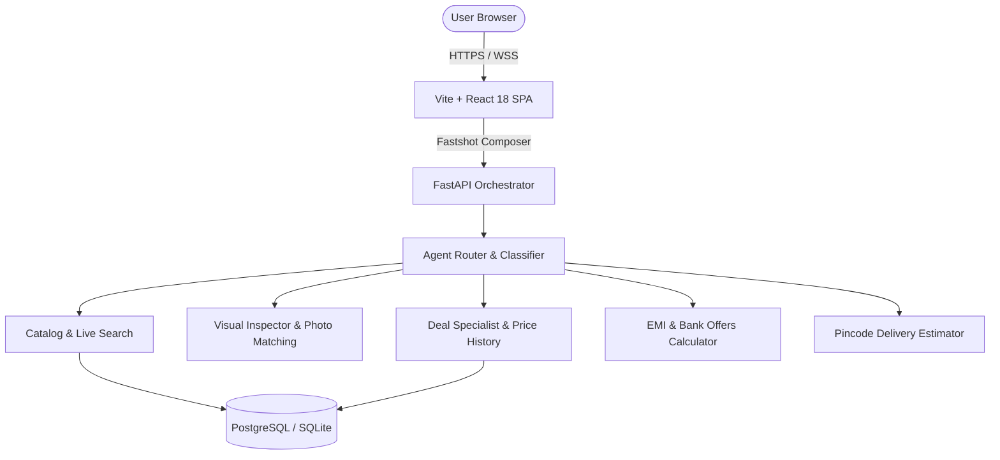

# ShopSense Architecture & Design Blueprint

## 1. System Overview
ShopSense is an AI-powered conversational e-commerce comparison shopping engine tailored for the Indian market. It features a Fastshot-inspired glassmorphic interface and a collaborative multi-agent backend orchestrator capable of real-time price intelligence, specification comparison, and financing breakdowns.

## 2. Frontend Architecture
- **Framework**: React 18 + Vite SPA with modern hooks and pure component isolation.
- **Visual Design**: Fastshot cinematic styling with ambient background video, subtle backdrop blurs (`backdrop-filter: blur(16px)`), and radial glow lighting.
- **Component Decomposition**:
  - `HeaderBrandMark`: Brand icon and responsive title display.
  - `FeaturePillBadges`: Navigation highlight badges.
  - `ComposerInput`: Glassmorphic dock with model dropdown and action cluster.
  - `ModelDropdown`: Dynamic AI engine selector ("Sonnet 4.5", "Gemini Flash", "Deal Specialist").
  - `QuickActionsToolbar`: Predefined action chips (Deals, Compare, EMI, Pincode).
  - `WelcomePromptGrid`: Empty-state conversational prompts.
  - `ProductCard` & `ProductDetailModal`: Indian e-commerce benchmark pricing and buy links.
  - `CartDrawer`: Unified drawer with simulated Razorpay sandbox payment.
- **Modular Stylesheet Hierarchy (`frontend/src/styles/`)**:
  - `variables.css`: Design tokens, colors, borders, typography reset.
  - `ambient.css`: Cinematic stage, overlays, and video container.
  - `navbar.css`: Navigation bar, action pill badges, and user menu.
  - `composer.css`: Dock, chips, prompt input, engine dropdown, and send action.
  - `products.css`: Product cards, detail modals, and deal tags.
  - `cart.css`: Cart drawer, item rows, and checkout simulator.
  - `auth.css`: Split-view authentication, interactive pull-cord desk lamp.
  - `chat.css`: Messages stream, user/assistant bubbles, and typing dots.
  - `markdown.css`: Responsive comparison tables and code formatting.
  - `responsive.css`: Mobile breakpoints and viewport constraints.
- **AI Streaming & State Architecture**:
  - Detailed production evaluation and blueprint documented in [`docs/FRONTEND_AI_STACK_SPEC.md`](./docs/FRONTEND_AI_STACK_SPEC.md) and [`docs/ai_frontend_stack_recommendation.json`](./docs/ai_frontend_stack_recommendation.json).
  - Recommended Stack: React 18/19 + Zustand transient store + `@microsoft/fetch-event-source` + Vercel AI SDK + `shadcn/ui` + `@tanstack/react-virtual`.
  - Client streaming utility: [`frontend/src/utils/aiStreamClient.js`](./frontend/src/utils/aiStreamClient.js) providing low-latency SSE chunk parsing, token dispatching, and `AbortController` cancellation.

## 3. Backend & Multi-Agent Orchestration
- **Runtime**: FastAPI with async route handlers and Pydantic v2 schemas.
- **Agent Roles**:
  - **Router Agent**: Analyzes user intent, checks for conversational queries, and dispatches to specialized tools.
  - **Visual Inspector Agent**: Uses Gemini multimodal capabilities to inspect photos, identify products, and detect spec discrepancies.
  - **Deal Specialist Agent**: Compares launch MRP vs current live price and analyzes promotional bank discounts.
  - **Finance Agent**: Computes reducing-balance EMI schedules, No-Cost EMI eligibility, and IFSC lookups.
  - **Logistics Agent**: Validates Indian PIN codes via Postal API with metro express turnaround estimates.

## 4. Quality & Testing Infrastructure
- **Frontend**: Node.js test runner (`node --test`) validating formatting utilities, API error mappings, and schema constants.
- **Backend**: Comprehensive Pytest suite covering authentication, injection defense, agent routing, and finance/logistics calculations (80+ passing tests).

## Prompt-Specific Shopping Response Pipeline

The chat orchestration uses a deterministic intent classifier and a constraint extractor before forming provider prompts. The current turn is classified into a supported shopping task (recommendation, comparison, deals, reviews, finance/EMI, gifts, delivery, product information, general shopping, clarification, or out-of-scope). A task-specific contract is appended to the existing system prompt; this does not require a second model call.

Explicit INR constraints such as a maximum/minimum budget, required features, excluded features, preferred/excluded brands, category, and use case are extracted from the current user message. Catalog candidates are filtered against hard constraints and stably re-ranked by supported preferences. USD figures are not treated as INR catalog ceilings. Required specifications must be evidenced by the product's description or attributes; unknown details are not silently treated as verified.

The multi-agent graph uses the same intent taxonomy, passes recent conversation history to its routing/search nodes, and routes genuinely ambiguous references to a one-question clarification node. The final response boundary normalizes blank/oversized responses, de-duplicates product IDs, removes stale product references when the database is available, keeps reason/pro/con maps aligned to valid IDs, and repairs raw Markdown comparison tables into readable product sections.

Regression coverage lives in backend/tests/test_intent_classifier.py, backend/tests/test_constraint_extractor.py, and backend/tests/test_prompt_pipeline.py. The new prompt pipeline is deterministic and introduces no separate LLM invocation.
